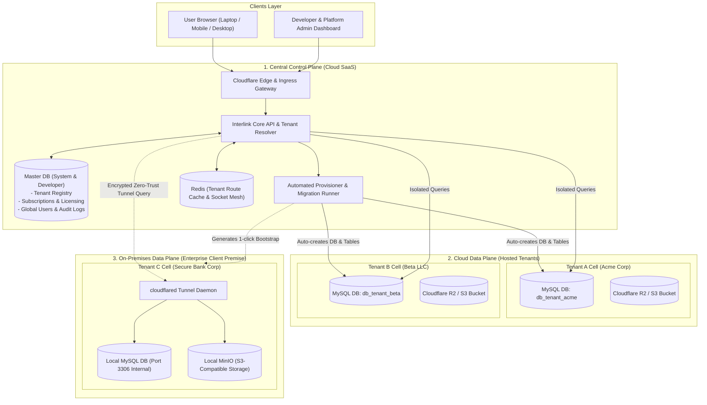
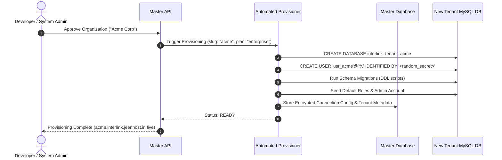
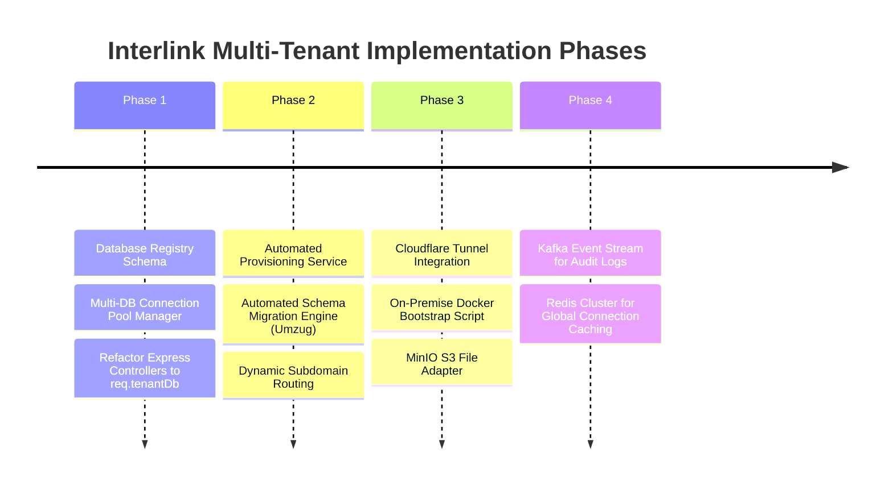

# Interlink Enterprise Multi-Tenant Architecture Specification
## Isolated Multi-Database, On-Premises Hybrid Deployment & Automated Provisioning

---

## 1. Executive Summary

This document specifies the enterprise architecture for **Interlink** to support:
1. **Isolated Multi-Tenancy (Database-per-Tenant)**: Complete physical separation of sensitive client data (chats, meetings, attendance, files, tasks).
2. **Central Master Control Plane**: A shared developer and system database for global authentication, tenant registries, licensing, billing, and platform analytics.
3. **Hybrid On-Premises Deployment**: Seamless capability for enterprise clients (e.g., banks, healthcare, government) to host their private database and file storage within their internal on-premises infrastructure.
4. **Zero-Trust Secure Tunneling via Cloudflare**: Encrypted outbound-only connectivity without opening inbound firewall ports or requiring static public IPs.
5. **100% Automated Provisioning**: Automated tenant database creation, schema migrations, and 1-click on-premise appliance bootstrapping.

---

## 2. Architecture Overview: Control Plane vs. Data Plane

The system adopts the **Cell-Based Control Plane / Data Plane Architecture** (used by enterprise platforms like Slack Enterprise Grid, Mattermost, and Snowflake).



---

## 3. Database Separation: Master DB vs. Tenant DBs

### A. Master (Developer / Platform) Database
Accessed strictly by developers, system services, and platform super-admins.

* **Database Name**: `interlink_master`
* **Contents**:
  - `tenants`: Core organization metadata, tenant slug (`acme`), custom domain (`chat.acme.com`), status (`active`, `suspended`), deployment type (`cloud`, `on_premise`).
  - `tenant_credentials`: Encrypted database host, port, DB name, username, and AES-256 encrypted password.
  - `master_users`: Platform developer and support staff accounts.
  - `subscription_plans` & `billing_invoices`: Tier limits, storage quotas, seat counts.
  - `platform_audit_logs`: Global telemetry, login anomalies, system health metrics.

### B. Isolated Tenant Databases
One physical database per tenant (`interlink_tenant_<uuid_or_slug>`).

* **Contents**:
  - `users`, `user_types`, `departments`, `user_departments`
  - `chat_channels`, `messages`, `direct_messages`, `message_attachments`
  - `meetings`, `meeting_participants`, `meeting_recordings`
  - `attendance_events`, `attendance_daily_summary`, `work_schedules`
  - `projects`, `tasks`, `reminders`

---

## 4. Why This is the Safest Option (Security & Safety Analysis)

| Security Aspect | Shared Database (Row-Level `organization_id`) | Control Plane / Data Plane (Multi-DB) |
| :--- | :--- | :--- |
| **Cross-Tenant Data Leakage** | **High Risk**: A single missing `WHERE organization_id = ?` clause leaks another company's confidential chats/meetings. | **Zero Risk**: Physical database separation. The database user for Tenant A has no grant or permission to access Tenant B's database. |
| **Blast Radius of Breach** | **Total**: A SQL injection compromise exposes every customer in the entire company. | **Contained**: A breach in one tenant exposes only that single tenant's database. |
| **Noisy Neighbor Impact** | **Severe**: One tenant running an intensive report or large meeting degrades performance for all other tenants. | **Isolated**: Each tenant runs on dedicated connection pools with independent queue limits. |
| **Compliance & Data Sovereignty** | Fails strict compliance for Banking, Defense, and Healthcare (HIPAA, SOC 2 Type II, ISO 27001). | **Compliant**: Supports Bring Your Own Key (BYOK), isolated backups, and true On-Premises data residency. |

---

## 5. Hybrid On-Premises Architecture via Cloudflare

For tenants requiring on-premises storage, **Cloudflare Tunnel (`cloudflared`)** eliminates the need for public IPs or open firewall ports.

```mermaid
flowchart LR
    subgraph InterlinkCloud["Interlink Cloud Backend"]
        NodeApp["Node.js Application Pool Manager"]
        ServiceKey["Cloudflare Access Service Token"]
    end

    subgraph CFEdge["Cloudflare Global Network"]
        CFZT["Cloudflare Zero Trust Gateway"]
    end

    subgraph TenantPremise["Tenant On-Premises Data Center / Server"]
        CFTunnel["cloudflared Daemon (Docker Container)"]
        LocalMySQL[("Local MySQL Server (127.0.0.1:3306)")]
        LocalMinIO[("Local MinIO S3 (127.0.0.1:9000)")]
    end

    NodeApp -->|Encrypted HTTPS/QUIC with Service Token| CFZT
    CFZT -->|Outbound-established reverse tunnel| CFTunnel
    CFTunnel -->|Internal LAN query| LocalMySQL
    CFTunnel -->|Internal LAN file upload| LocalMinIO

    CFTunnel -.->|Outbound Port 443 Only (No inbound ports)| CFZT
```

### Why Corporate IT Teams Approve Cloudflare Tunnel:
1. **Zero Open Inbound Ports**: The `cloudflared` agent establishes an **outbound-only** connection to Cloudflare edge over TLS 1.3. Port 3306 is never exposed to the public internet.
2. **No Static Public IP Required**: Operates behind enterprise firewalls, NAT, and Carrier-Grade NAT (CGNAT).
3. **Restricted Access via Service Tokens**: Only requests originating from the Interlink backend carrying cryptographic Cloudflare Access Service Tokens can route traffic through the tunnel.

---

## 6. End-User (Employee) Experience

> [!IMPORTANT]
> **End-users (employees, managers, attendees) never install Docker, databases, or tunnels on their personal laptops or phones.**

* **User Workflow**: Users open their standard web browser (Chrome, Safari, Edge) or mobile browser and navigate to `https://acme.interlink.jeenhost.in` or `https://chat.acmecorp.com`.
* **Zero Client Footprint**: The application functions identically to standard SaaS, with all routing handled transparently on the backend.

---

## 7. 100% Automated Configuration Workflows

### Workflow 1: Automated Cloud Tenant Provisioning

When an organization registers and is approved via the Developer Admin Panel:



#### Automated DDL Generation (Node.js Automation):
```javascript
// backend/services/provisioningService.js
const mysql = require("mysql2/promise");
const crypto = require("crypto");
const { runMigrationsOnDb } = require("./migrationRunner");
const { getMasterDb } = require("../config/multiDbManager");
const { encrypt } = require("../utils/encryption");

async function provisionCloudTenant({ organizationName, slug, adminEmail, adminPasswordHash }) {
    const masterDb = getMasterDb();
    const dbName = `interlink_tenant_${slug.replace(/[^a-z0-9_]/gi, "")}`;
    const dbUser = `usr_${slug.substring(0, 10)}_${crypto.randomBytes(3).toString("hex")}`;
    const dbPass = crypto.randomBytes(16).toString("hex");

    // 1. Create isolated DB and least-privilege user
    const rootConn = await mysql.createConnection({
        host: process.env.DB_CLUSTER_HOST,
        user: process.env.DB_CLUSTER_ROOT_USER,
        password: process.env.DB_CLUSTER_ROOT_PASSWORD
    });

    try {
        await rootConn.query(`CREATE DATABASE \`${dbName}\` CHARACTER SET utf8mb4 COLLATE utf8mb4_unicode_ci;`);
        await rootConn.query(`CREATE USER '${dbUser}'@'%' IDENTIFIED BY '${dbPass}';`);
        await rootConn.query(`GRANT ALL PRIVILEGES ON \`${dbName}\`.* TO '${dbUser}'@'%';`);
        await rootConn.query(`FLUSH PRIVILEGES;`);
    } finally {
        await rootConn.end();
    }

    // 2. Run automated schema migrations on the new database
    const tenantConn = await mysql.createConnection({
        host: process.env.DB_CLUSTER_HOST,
        user: dbUser,
        password: dbPass,
        database: dbName
    });

    try {
        await runMigrationsOnDb(tenantConn);

        // 3. Seed organization owner account
        await tenantConn.query(
            "INSERT INTO users (username, email, password_hash, role, status) VALUES (?, ?, ?, 'admin', 'active')",
            ["admin", adminEmail, adminPasswordHash]
        );
    } finally {
        await tenantConn.end();
    }

    // 4. Save encrypted credentials in Master DB
    await masterDb.query(
        `INSERT INTO tenant_registry 
        (organization_name, slug, deployment_type, db_host, db_port, db_name, db_user, db_pass_encrypted, status) 
        VALUES (?, ?, 'cloud', ?, 3306, ?, ?, ?, 'active')`,
        [organizationName, slug, process.env.DB_CLUSTER_HOST, dbName, dbUser, encrypt(dbPass)]
    );

    return { success: true, slug, dbName };
}
```

---

### Workflow 2: Automated On-Premises Appliance Provisioning

When an enterprise client opts for On-Premises data hosting:

1. **Token Generation**: The Master Admin Panel issues a cryptographically signed `ONPREM_SETUP_TOKEN`.
2. **Cloudflare Tunnel Auto-Creation**: The system calls Cloudflare's API to register a tunnel specifically for this tenant (`tunnel-<slug>`).
3. **One-Line IT Bootstrap**: The client's IT administrator runs a single shell command on their server:

```bash
curl -sSL https://interlink.jeenhost.in/install/bootstrap.sh | \
  TENANT_TOKEN="eyJhbGciOi..." bash
```

#### What `bootstrap.sh` executes automatically on the Client Server:
* Pulls and runs an isolated **Docker Compose** stack:
  - `mysql:8.0` with persistent local disk storage.
  - `minio/minio` for local file storage.
  - `cloudflare/cloudflared` pre-configured with the tunnel credentials.
* Runs table initialization and schema migrations locally.
* Reports `STATUS: OPERATIONAL` back to the Master Control Plane.

---

### Workflow 3: Automated Zero-Downtime Multi-Database Migrations

When developers release code updates involving new tables or columns:

1. **Migration Registry**: Migrations are versioned scripts (e.g. `20261127_add_meeting_reactions.sql`).
2. **Dynamic Migration Runner**:
   - Queries `master_db.tenant_registry` for all active tenants.
   - Executes migrations concurrently across all tenant databases (Cloud + On-Premises via Tunnels).
   - Records migration state in each database's `_migrations` tracking table.
   - If a failure occurs on one tenant, it logs the error, alerts developers, and leaves remaining tenants untouched.

---

## 8. Runtime Request Routing in Node.js

Below is the dynamic connection pooling implementation for `backend/`:

### 1. Dynamic Pool Manager (`backend/config/tenantDbManager.js`)
```javascript
const mysql = require("mysql2/promise");
const { decrypt } = require("../utils/encryption");

const tenantPools = new Map();
let masterPool = null;

function getMasterDb() {
    if (!masterPool) {
        masterPool = mysql.createPool({
            host: process.env.MASTER_DB_HOST || "localhost",
            user: process.env.MASTER_DB_USER || "root",
            password: process.env.MASTER_DB_PASSWORD || "",
            database: process.env.MASTER_DB_NAME || "interlink_master",
            waitForConnections: true,
            connectionLimit: 10
        });
    }
    return masterPool;
}

async function getTenantDb(tenantIdentifier) {
    if (!tenantIdentifier) return getMasterDb();

    if (tenantPools.has(tenantIdentifier)) {
        return tenantPools.get(tenantIdentifier);
    }

    const master = getMasterDb();
    const [rows] = await master.query(
        "SELECT * FROM tenant_registry WHERE slug = ? OR id = ? LIMIT 1",
        [tenantIdentifier, tenantIdentifier]
    );

    if (!rows.length) {
        throw new Error(`Tenant '${tenantIdentifier}' not found in registry.`);
    }

    const tenant = rows[0];
    const poolConfig = {
        host: tenant.db_host,
        port: tenant.db_port || 3306,
        user: tenant.db_user,
        password: decrypt(tenant.db_pass_encrypted),
        database: tenant.db_name,
        waitForConnections: true,
        connectionLimit: 8,
        queueLimit: 0
    };

    // If tenant is on-premise, route through Cloudflare Zero Trust headers/certs
    if (tenant.deployment_type === "on_premise") {
        poolConfig.ssl = { rejectUnauthorized: true };
    }

    const pool = mysql.createPool(poolConfig);
    tenantPools.set(tenantIdentifier, pool);
    return pool;
}

module.exports = { getMasterDb, getTenantDb };
```

### 2. Tenant Context Middleware (`backend/middleware/tenantResolver.js`)
```javascript
const { getMasterDb, getTenantDb } = require("../config/tenantDbManager");

async function tenantResolver(req, res, next) {
    try {
        req.masterDb = getMasterDb();

        // Detect tenant from subdomain (acme.interlink.jeenhost.in) or JWT user payload
        const host = req.headers.host || "";
        const subdomain = host.split(".")[0];
        const tenantSlug = req.user?.organization_slug || (subdomain !== "interlink" ? subdomain : null);

        if (tenantSlug) {
            req.tenantDb = await getTenantDb(tenantSlug);
        } else {
            req.tenantDb = req.masterDb;
        }

        next();
    } catch (err) {
        console.error("Tenant resolution error:", err.message);
        res.status(500).json({ success: false, message: "Database connection failed for tenant." });
    }
}

module.exports = tenantResolver;
```

---

## 9. Technology Stack Matrix

| Purpose | Tool / Technology | Architectural Role |
| :--- | :--- | :--- |
| **Control Plane DB** | **MySQL 8.0 / PostgreSQL** | Manages tenant registry, billing, and platform credentials. |
| **Tenant DB Engine** | **MySQL 8.0 (InnoDB)** | High-performance isolated relational storage for chat/meetings/HR. |
| **Encrypted Tunnels** | **Cloudflare Tunnel (`cloudflared`)** | Secure outbound-only tunnels for on-premises client databases. |
| **Access Control** | **Cloudflare Zero Trust** | Authenticates backend requests to on-premises tunnels via Service Tokens. |
| **Custom Domains** | **Cloudflare for SaaS** | Provides automated SSL and domain routing (e.g. `chat.client.com`). |
| **File Storage** | **MinIO (On-Prem) & Cloudflare R2 (Cloud)** | Uniform S3-compatible API for chat files, meeting recordings, and avatars. |
| **Multi-DB Migrations**| **Umzug (Node.js) / Flyway** | Automated, programmatically triggered DDL migrations across tenant pools. |
| **Event Streaming** | **Apache Kafka / Redpanda** | Asynchronous decoupled audit logging and cross-database event telemetry. |
| **In-Memory Cache** | **Redis** | Caches active tenant route lookups and coordinates Socket.IO scaling. |

---

## 10. Phased Implementation Plan



1. **Phase 1: Multi-DB Abstraction in Code**:
   - Create `tenant_registry` table in Master DB.
   - Replace static `db.js` imports with `req.tenantDb` provided by `tenantResolver` middleware.
2. **Phase 2: Automated Provisioning**:
   - Build `provisioningService.js` to create databases, users, and run initial migrations automatically on organization approval.
3. **Phase 3: Hybrid On-Premises via Cloudflare**:
   - Package the on-premises Docker Compose appliance with `cloudflared` + `mysql` + `minio`.
   - Implement `bootstrap.sh` 1-click installer for enterprise IT administrators.
4. **Phase 4: Telemetry & Asynchronous Workers**:
   - Integrate Redis for caching tenant connection routes.
   - Deploy Kafka/Redpanda for non-blocking audit logging and usage billing.
