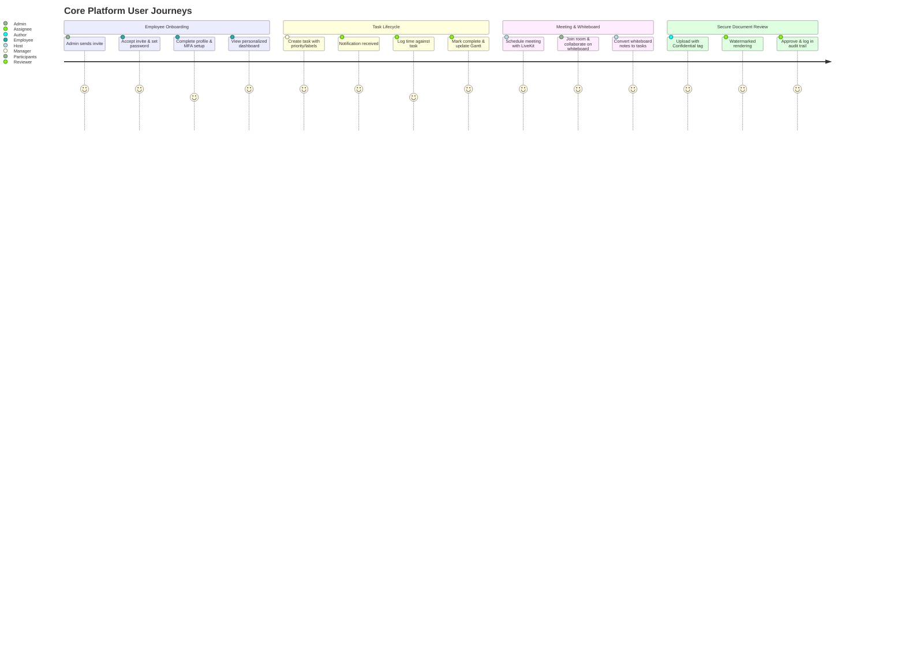

# UI/UX Specification & Mandatory Development Guidelines
**Project:** Interlink — Enterprise Collaboration & Business Management SaaS  
**Platforms:** Responsive Web, Android, iOS  
**Document Version:** 1.0  
**Effective Date:** 21 November 2026  
**Status:** Canonical Source of Truth for all UI/UX & Frontend Development

---

> ### ⚠️ STRICT GOVERNANCE DIRECTIVE
> **All future UI/UX development across Web, Android, and iOS must strictly follow the specifications, design tokens, component standards, screen inventories, and behavioral rules defined in this document.**  
> - No dead-end buttons, placeholder cards, lorem ipsum, or fake success messages.
> - No deviation from design tokens (Navy `#17365D`, Accent `#2878C7`, Canvas `#F6F8FB`).
> - Every screen must provide all required states: `loading`, `empty`, `no-results`, `error/retry`, `permission-denied`, and `success`.
> - Purchase-request approval is **strictly excluded** — never add it to navigation, workflows, database, or UI.

---

## Table of Contents
1. [Product Baseline & Non-Negotiable Decisions](#1-product-baseline--non-negotiable-decisions)
2. [Visual Design System & Design Tokens](#2-visual-design-system--design-tokens)
   - [2.1 Art Direction](#21-art-direction)
   - [2.2 Design Tokens](#22-design-tokens)
   - [2.3 Core Application Shell (Web)](#23-core-application-shell-web)
   - [2.4 Mobile Design Language (Android & iOS)](#24-mobile-design-language-android--ios)
   - [2.5 Global Reusable Component Library](#25-global-reusable-component-library)
3. [Full Screen Inventory & Screen Behavior (80+ Screens)](#3-full-screen-inventory--screen-behavior)
   - [3.1 Authentication & Account (`AUTH-01` to `AUTH-05`)](#31-authentication--account)
   - [3.2 Dashboard & My Work (`DASH-01` to `DASH-03`)](#32-dashboard--my-work)
   - [3.3 Organization & Employees (`EMP-01` to `EMP-05`)](#33-organization--employees)
   - [3.4 Chat & Communication (`CHAT-01` to `CHAT-07`)](#34-chat--communication)
   - [3.5 Meetings & Whiteboard (`MEET-01` to `MEET-05`)](#35-meetings--whiteboard)
   - [3.6 Email Workspace (`MAIL-01` to `MAIL-07`)](#36-email-workspace)
   - [3.7 Tasks & Projects (`TASK-01` to `TASK-05`, `PROJ-01` to `PROJ-06`)](#37-tasks--projects)
   - [3.8 Calendar, Reminders, Notes & Knowledge (`CAL-01` to `CAL-04`, `NOTE-01` to `NOTE-03`, `KB-01` to `KB-04`)](#38-calendar-reminders-notes--knowledge)
   - [3.9 Document Management & Security (`DOC-01` to `DOC-16`)](#39-document-management--security)
   - [3.10 Forms, Tickets & Operations (`FORM-01` to `FORM-04`, `TICKET-01` to `TICKET-04`, `ATT-01` to `ATT-03`, `TIME-01` to `TIME-03`, `EXP-01` to `EXP-04`)](#310-forms-tickets--operations)
   - [3.11 Performance, Workflows, Reports & Settings (`PERF-01` to `PERF-04`, `WF-01` to `WF-03`, `REP-01` to `REP-03`, `INT-01` to `INT-02`, `SET-01` to `SET-05`)](#311-performance-workflows-reports--settings)
   - [3.12 SaaS Platform Management (`SAAS-01` to `SAAS-05`)](#312-saas-platform-management)
4. [Cross-Platform User Journeys](#4-cross-platform-user-journeys)
5. [Platform Master Execution Prompts](#5-platform-master-execution-prompts)
   - [5.1 Web Application Master Prompt](#51-web-application-master-prompt)
   - [5.2 Android Application Master Prompt](#52-android-application-master-prompt)
   - [5.3 iOS Application Master Prompt](#53-ios-application-master-prompt)
6. [Implementation Workflow & Phasing](#6-implementation-workflow--phasing)
7. [Quality Gates & Acceptance Checklist](#7-quality-gates--acceptance-checklist)
8. [Figma Handoff Deliverables & Open Decisions](#8-figma-handoff-deliverables--open-decisions)

---

## 1. Product Baseline & Non-Negotiable Decisions

| Area | Decision & Requirement |
| :--- | :--- |
| **Product Model** | Multi-tenant SaaS for SMBs & large enterprises, with private/self-hosted deployment capability. |
| **Platforms** | Responsive Web App, Native/Cross-platform Android app, and iOS app. |
| **Database** | **MySQL 8.x is mandatory.** Do not substitute PostgreSQL or alter without explicit product approval. |
| **Architecture** | Modular monolith with strict domain boundaries; designed for future microservice extraction. |
| **Web Tech Stack** | Next.js / React, TypeScript, Tailwind CSS, Vite/Next toolchain. |
| **Backend Tech Stack**| NestJS / Node.js, TypeScript, Prisma or TypeORM, Redis, BullMQ, WebSockets, S3-compatible storage. |
| **Meetings** | WebRTC with LiveKit or equivalent managed/self-hostable media infrastructure. |
| **Email** | Connect existing providers (Google Workspace, Microsoft 365, cPanel IMAP/SMTP, Zoho Mail). **Do not build email hosting.** |
| **Global Metadata** | Universal labels and priority levels applied consistently across tasks, projects, docs, tickets, and emails. |
| **Chat Rule** | Group chat setting: **"Only administrators can send messages"** enforced on server and UI. Support broadcast groups & announcements. |
| **Notes** | Private notes by default, with selected-user sharing supporting discrete view, edit, and comment permissions. |
| **Documents** | Granular access, classification levels, dynamic watermarking, audit logs, DLP controls, and secure rendering. |
| **Attendance & Time**| Daily check-in/out/break tracking + project/task-linked hourly timesheets with approval workflows. |
| **People Operations**| Expenses, allowances, reimbursements, performance reviews, goals/OKRs, feedback, and skills tracking. |
| **Strict Exclusion** | **DO NOT IMPLEMENT PURCHASE-REQUEST APPROVAL.** Do not introduce it into navigation, workflows, schema, or tests. |

---

## 2. Visual Design System & Design Tokens

### 2.1 Art Direction
- **Vibe:** Premium, calm, modern enterprise SaaS interface. Trustworthy, responsive, and efficient.
- **Theme:** Clean light theme by default; system-aware optional dark theme.
- **Aesthetic Principles:**
  - Avoid excessive gradients, heavy glassmorphism, or decorative/uninformative charts.
  - Avoid oversized empty hero banners and inconsistent card padding.
  - Maintain high information density while providing comfortable breathing room (4px scale).

### 2.2 Design Tokens

```css
:root {
  /* Primary & Brand */
  --color-primary: #17365D;          /* Deep navy: navigation, headings, high-trust actions */
  --color-primary-hover: #102642;
  --color-accent: #2878C7;           /* Active blue: primary interactive elements, links */
  --color-accent-hover: #1e63a8;

  /* Neutrals & Surfaces */
  --color-canvas: #F6F8FB;           /* Global background behind cards */
  --color-surface: #FFFFFF;          /* Cards, panels, modals */
  --color-surface-hover: #F8FAFC;
  --color-border: #E2E8F0;           /* Dividers, control outlines */
  --color-border-subtle: #EDF2F7;

  /* Typography Colors */
  --color-text-primary: #17212F;     /* High contrast body and titles */
  --color-text-secondary: #5B6573;   /* Metadata, captions, secondary labels */
  --color-text-muted: #94A3B8;       /* Placeholders, disabled states */

  /* Semantic Feedback */
  --color-success: #10B981;          /* Green: completed, healthy, present */
  --color-warning: #F59E0B;          /* Amber: pending, due soon, warning */
  --color-danger: #EF4444;           /* Red: overdue, error, blocked, destructive */
  --color-info: #3B82F6;             /* Blue: informational banners */

  /* Typography */
  --font-family: 'Inter', -apple-system, BlinkMacSystemFont, 'Segoe UI', Roboto, sans-serif;
  --font-size-h1: 32px;
  --font-size-h2: 24px;
  --font-size-h3: 18px;
  --font-size-body: 14px;            /* 14px–16px */
  --font-size-sm: 13px;              /* Metadata */
  --font-size-xs: 11px;              /* Badges, tags */

  /* Spacing Scale (4px base) */
  --space-1: 4px;
  --space-2: 8px;
  --space-3: 12px;
  --space-4: 16px;
  --space-6: 24px;
  --space-8: 32px;

  /* Radii */
  --radius-sm: 6px;                  /* Controls, badges */
  --radius-md: 8px;                  /* Inputs, buttons, cards */
  --radius-lg: 10px;                 /* Modals, drawers */
  /* Avoid excessive pill shapes (>24px) except for avatar circles */

  /* Elevation & Shadow */
  --shadow-sm: 0 1px 2px rgba(0, 0, 0, 0.05);
  --shadow-md: 0 4px 6px -1px rgba(0, 0, 0, 0.08), 0 2px 4px -1px rgba(0, 0, 0, 0.04);
  --shadow-lg: 0 10px 15px -3px rgba(0, 0, 0, 0.1);
}
```

### 2.3 Core Application Shell (Web)
1. **Left Sidebar:**
   - Collapsible with icon + text label.
   - Grouped logical sections (Dashboard, Communication, Productivity, People, Operations, SaaS/Admin).
   - Tenant feature flags & RBAC permission-aware visibility (unauthorized items are never visible).
2. **Top Bar:**
   - Tenant / Workspace switcher.
   - Global search input (`Ctrl+K` / `Cmd+K`).
   - Quick-create dropdown (+ Task, + Note, + Meeting, + Event, + Ticket).
   - Notification bell with unread badge counter.
   - Help / Documentation link.
   - User profile dropdown with status toggle (Online, Busy, Away).
3. **Main Content Container:**
   - Breadcrumb navigation.
   - Page header: Title, contextual status badge, and primary action button (e.g., "New Task").
   - Filter bar: Search, dropdown filters, column configuration, and saved view tabs.
   - Content area: Data table, Kanban board, calendar, or grid.
4. **Contextual Right Drawer:**
   - Slides in over content without resetting navigation.
   - Displays task details, comments feed, activity timeline, or document metadata.
5. **Data Tables:**
   - Sticky header row on scroll.
   - Sortable columns, custom column selector, density switch (compact/normal).
   - Multi-row bulk selection bar (Bulk Assign, Bulk Label, Archive).
   - Full pagination controls with rows-per-page selector.
6. **Form Interactions:**
   - Floating or explicit clear labels with red asterisks for required fields.
   - Real-time inline field validation and helpful hint text.
   - Sticky footer with Cancel and Primary Submit buttons.
   - Protection against accidental unsaved changes with dirty-form modal warning.

### 2.4 Mobile Design Language (Android & iOS)
- **Bottom Navigation Hub:** 5 core tabs: `Home`, `Chat`, `My Work`, `Notifications`, `More`.
- **"More" Hub:** Dynamically categorizes remaining authorized modules (Documents, Timesheets, Expenses, Attendance, Directory).
- **Touch Ergonomics:** Interactive touch targets minimum **48x48dp**.
- **Inputs & Modals:** Native bottom sheets for filters/pickers; full-screen overlays for complex data entry forms.
- **Native OS Conventions:**
  - Android: Edge-to-edge support, predictive back, Material bottom sheets, notification channels.
  - iOS: Safe-area insets, Dynamic Type scaling, VoiceOver, LocalAuthentication (Face ID / Touch ID).

### 2.5 Global Reusable Component Library
Every UI implementer must reuse these standardized components:
- **Buttons:** Primary (`#17365D`), Secondary (Outline), Tertiary (Ghost), Destructive (`#EF4444`), Icon-only with tooltip.
- **Input Controls:** Text Input, Password (with eye toggle), Textarea, Markdown/Rich-Text Editor, Select, Multi-select Combobox, Date/Time Picker.
- **Data Filtering:** Search Input with clear trigger, Filter Builder pill group, Saved Views dropdown.
- **Chips & Badges:** Status Chips (Draft, In Progress, Under Review, Completed, Overdue), Priority Chips (Low, Medium, High, Urgent), Universal Labels.
- **User Indicators:** Avatar with presence dot, Employee Selector, Team/Department Pill.
- **Layout Panels:** Cards with header/body/footer, Responsive Tables, Kanban Columns, Tabs, Breadcrumbs, Drawers, Modal Dialogs.
- **Feedback & States:** Loading Skeletons, Spinners, Toasts, Inline Alert Banners, Empty States with action button, Error States with retry button, 403 Access Denied screen.

---

## 3. Full Screen Inventory & Screen Behavior

Every screen in this inventory must be fully developed with realistic sample data, working API wiring, role-based visibility, and all mandatory states (`loading`, `empty`, `error`, `success`).

```
Screen Inventory Coverage Matrix
├── AUTH:  01 Login, 02 MFA, 03 Forgot Password, 04 Reset Password, 05 Setup
├── DASH:  01 Main Dashboard, 02 My Work, 03 My Activity
├── EMP:   01 Directory, 02 Add/Edit, 03 Profile, 04 Depts & Teams, 05 Org Chart
├── CHAT:  01 Inbox, 02 Direct Chat, 03 Create Group, 04 Group Settings, 05 Broadcast, 06 Announcements, 07 Files
├── MEET:  01 Dashboard, 02 Schedule, 03 Room (LiveKit), 04 Whiteboard, 05 Details
├── MAIL:  01 Inbox, 02 Compose, 03 Details, 04 Connected Accounts, 05 Rules, 06 Directory, 07 Monitoring
├── TASK:  01 Dashboard, 02 Views (List/Board/Calendar/Gantt), 03 Create/Edit, 04 Details, 05 Gantt
├── PROJ:  01 Dashboard, 02 List, 03 Create/Edit, 04 Workspace, 05 Subprojects, 06 Project Gantt
├── CAL:   01 Calendar, 02 Create Event, 03 Reminders, 04 Notification Settings
├── NOTE:  01 Notes List, 02 Rich Editor, 03 Share Permissions
├── KB:    01 Knowledge Home, 02 Article Detail, 03 Article Editor, 04 Approval Queue
├── DOC:   01-16 Document Center, Folders, Upload, Secure Viewer, Permissions, Watermark, Audit, DLP, Retention
├── FORM:  01 Dashboard, 02 Builder, 03 Responses, 04 Polls & Surveys
├── TICKET:01 Dashboard, 02 Create, 03 Details, 04 Admin
├── ATT:   01 Dashboard, 02 My Attendance, 03 Attendance Admin
├── TIME:  01 Timesheets, 02 Add Time, 03 Timesheet Approvals
├── EXP:   01 Dashboard, 02 Submit Expense, 03 Allowances, 04 Reimbursement Approval
├── PERF:  01 Dashboard, 02 Goals & OKRs, 03 Review Wizard, 04 History
├── WF:    01 Approval Inbox, 02 Builder, 03 Execution Details
├── REP:   01 Dashboard, 02 Report Builder, 03 Schedules
├── INT:   01 Marketplace, 02 Integration Details
├── SET:   01 Company, 02 Users & Roles, 03 Labels & Priorities, 04 Security, 05 Usage
└── SAAS:  01 Super-Admin Dashboard, 02 Tenants, 03 Plans, 04 Monitoring, 05 Licenses
```

---

### 3.1 Authentication & Account

#### `AUTH-01` — Login
- **Purpose:** Secure authentication into a tenant workspace.
- **Layout:** Centered branded card with tenant logo, email/username, password, and SSO options.
- **Components:** Email field, password field with show/hide toggle, Remember Me checkbox, SSO buttons (Google, Azure AD/O365, SAML), "Forgot Password" link, Tenant Switcher link.
- **States:** Idle, Submitting, Invalid Credentials, Account Locked (rate limit), SSO Redirecting.
- **Security:** Do not disclose whether email exists; rate limit attempts server-side.

#### `AUTH-02` — Multi-Factor Verification (MFA)
- **Purpose:** 2-step verification using TOTP Authenticator or SMS/Email code.
- **Layout:** Card with 6-digit OTP input blocks, timer countdown, and fallback option.
- **Components:** Auto-advancing digit inputs, "Resend Code" (with 60s cooldown), "Use Recovery Code" toggle, "Trust this device for 30 days" checkbox.
- **States:** Code Entry, Verifying, Invalid Code, Expired Code, Throttled.

#### `AUTH-03` — Forgot Password
- **Purpose:** Request credential recovery email.
- **Layout:** Single-column card with instructions and email field.
- **Components:** Email field, "Send Reset Link" button, "Back to Login" button.
- **States:** Idle, Sending, Generic Success Message (always shown to prevent email enumeration).

#### `AUTH-04` — Reset Password
- **Purpose:** Set new password from verified token link.
- **Layout:** Form with password strength indicator and confirmation input.
- **Components:** New password, confirm password, dynamic criteria checklist (min 10 chars, uppercase, digit, symbol).
- **States:** Validating, Mismatch, Expired/Invalid Token, Success with redirect countdown.

#### `AUTH-05` — First-Time Setup Wizard
- **Purpose:** Onboard invited employees on first login.
- **Layout:** Stepper wizard: 1. Profile Details & Photo → 2. Timezone & Locale → 3. Notification Preferences → 4. Policy Acknowledgement.
- **Components:** Avatar upload, timezone selector, language dropdown, acknowledgement checkboxes, "Get Started" button.

---

### 3.2 Dashboard & My Work

#### `DASH-01` — Main Dashboard
- **Purpose:** Operational executive overview tailored to the user's role.
- **Layout:** Top metric summary bar, 2-column customizable widget grid, right-hand activity feed.
- **Components:**
  - Metric Cards: My Pending Tasks, Approvals Awaiting Action, Upcoming Meetings, Timesheet Status.
  - Widgets: Quick-access tasks, meeting countdown with direct "Join Room" button, unread chat preview, company announcements carousel.
  - Actions: Rearrange widgets, date range picker, quick create button.
- **States:** Loading skeletons, empty widget states, partial error state.

#### `DASH-02` — My Work
- **Purpose:** Consolidated single-pane view of all work assigned to or owned by current user.
- **Layout:** Tabbed table/card view (`Assigned to Me`, `Created by Me`, `Approvals`, `Tickets`, `Documents to Review`).
- **Components:** Unified search, filter by module, status chip, priority chip, due date highlighter, inline quick-status update.

#### `DASH-03` — My Activity
- **Purpose:** Audit and operational timeline of all personal actions and mentions.
- **Layout:** Vertical chronological feed with date dividers.
- **Components:** Filter by action type (Edits, Mentions, Approvals, File Uploads), direct link to referenced entities.

---

### 3.3 Organization & Employees

#### `EMP-01` — Employee Directory
- **Purpose:** Searchable and filterable employee directory.
- **Layout:** Top filter bar (Department, Branch, Status), grid/table view toggle, search bar.
- **Components:** Avatar, full name, employee code, job title, department, manager, work email, status badge (Active, On Leave, Suspended).
- **Actions:** Add Employee (admin), Export CSV, Bulk Invite, View Profile.

#### `EMP-02` — Add / Edit Employee Form
- **Purpose:** Create or modify employee record and account access.
- **Layout:** Multi-section form: Personal Information, Employment Details, Org Placement, System Role & Permissions.
- **Components:** Employee ID, First/Last Name, Work Email, Phone, Hire Date, Employment Type (Full-Time, Contract, Intern), Department, Reporting Manager, Role Selector (Admin, Manager, Member, Custom).

#### `EMP-03` — Employee Profile
- **Purpose:** Comprehensive 360-degree profile of an employee.
- **Layout:** Header summary card + tabbed deep navigation (`Overview`, `Assigned Tasks`, `Projects`, `Attendance & Timesheets`, `Documents`, `Performance Goals`, `Activity History`).
- **Security:** Sensitive tabs (Salary/Bank, Performance Reviews) restricted to HR/Manager roles.

#### `EMP-04` — Departments & Teams
- **Purpose:** Structural hierarchy management.
- **Layout:** Two-column split: Department tree list on left; Department details, teams, and member list on right.
- **Actions:** Create Department, Add Sub-team, Assign Department Head, Transfer Members.

#### `EMP-05` — Interactive Organization Chart
- **Purpose:** Visual reporting hierarchy explorer.
- **Layout:** Pan and zoom canvas with collapsible tree nodes.
- **Components:** Search person to focus node, zoom controls, fit-to-screen button, mini-profile flyout card.

---

### 3.4 Chat & Communication

#### `CHAT-01` — Chat Inbox
- **Purpose:** Unified messaging hub for Direct Messages, Channels, and Announcement Groups.
- **Layout:** 3-column desktop layout: Conversations list (left), Active message thread (center), Conversation details/files (right).
- **Components:** Search bar, category filters (`Unread`, `Direct`, `Groups`, `Announcements`), pinned conversations.

#### `CHAT-02` — One-to-One & Team Chat
- **Purpose:** Real-time messaging with rich text and file sharing.
- **Layout:** Message timeline with sender avatars, grouped time separators, and bottom fixed rich-text composer.
- **Components:** Markdown formatting bar, emoji picker, attachment upload, voice note recorder, message action menu (Reply in thread, React, Pin, Convert to Task, Bookmark).
- **States:** Sending, Sent, Delivered, Read, Connection Disconnected / Reconnecting bar.

#### `CHAT-03` — Create Group Dialog
- **Purpose:** Create private, public, or announcement channels.
- **Layout:** Modal with Group Name, Description, Avatar icon picker, Privacy toggle (Public/Private), and Multi-select Member Picker.

#### `CHAT-04` — Group Settings & Governance
- **Purpose:** Manage members, roles, and posting permissions.
- **Key Mandatory Setting:** **"Only administrators can send messages"** toggle (broadcast/announcement mode).
- **Components:** Member list with "Make Admin" / "Remove" actions, Notification mute settings, Archive Channel button.

#### `CHAT-05` — Broadcast Groups
- **Purpose:** Departmental or company-wide 1-way communication channels.
- **Layout:** Targeted audience picker (by Department, Branch, or Role), scheduling tool, and delivery statistics viewer (Read Receipts count).

#### `CHAT-06` — Company Announcements
- **Purpose:** Prominent, high-visibility corporate bulletins.
- **Layout:** Feed of announcement cards with priority badges (`Urgent`, `Company Update`, `Policy Change`), mandatory read-acknowledgement button, and comments section.

#### `CHAT-07` — Shared Chat Media & Files
- **Purpose:** Centralized gallery of files exchanged within a conversation.
- **Layout:** Tabbed browser: `Documents`, `Media / Images`, `Links`. Includes search and direct download/preview.

---

### 3.5 Meetings & Whiteboard

#### `MEET-01` — Meetings Dashboard
- **Purpose:** Schedule and join scheduled video conferences.
- **Layout:** "Upcoming Meetings" list with large countdown join cards, and "Past Meetings" archive with recording/summary links.

#### `MEET-02` — Schedule Meeting
- **Purpose:** Create calendar-integrated video meeting.
- **Components:** Title, Date/Time picker, Timezone, Recurrence, Invitees (Users, Teams, External Emails), Meeting Password, Waiting Room toggle, Auto-record toggle.

#### `MEET-03` — Live Meeting Room (LiveKit WebRTC)
- **Purpose:** Real-time multi-party video conferencing.
- **Layout:** Video participant grid, active speaker highlighting, bottom control toolbar, and collapsible side panel (Chat, Participants, Settings).
- **Controls:** Mute/Unmute Mic, Video On/Off, Screen Share, Collaborative Whiteboard switch, Raise Hand, Leave Meeting.
- **States:** Connecting, Connected, Poor Network warning, Recording in Progress banner.

#### `MEET-04` — Collaborative Whiteboard
- **Purpose:** Real-time multi-user drawing and brainstorming canvas.
- **Components:** Infinite canvas, tool palette (Select, Pen, Highlighter, Shapes, Sticky Notes, Text, Image Upload, Connector Lines), participant presence cursors, Undo/Redo, Export to PDF/PNG.

#### `MEET-05` — Meeting Details & Artifacts
- **Purpose:** Post-meeting summary and actionable follow-ups.
- **Components:** Attendee presence log, meeting recording player, AI transcript & summary, and "Convert Action Items to Tasks" button.

---

### 3.6 Email Workspace

> **Integration Note:** Email connects via OAuth / IMAP / SMTP to Gmail, Outlook 365, Zoho, or cPanel. Interlink does not host mail servers.

#### `MAIL-01` — Email Inbox
- **Purpose:** Unified mailbox client for connected work email accounts.
- **Layout:** 3-pane split: Folders rail (Inbox, Sent, Drafts, Archive, Spam, Custom Folders), Message List with sender/subject/date, and Message Preview Pane.

#### `MAIL-02` — Compose Email
- **Purpose:** Rich email composition.
- **Components:** From account selector, To/CC/BCC chip inputs with auto-complete from employee directory, Subject, Rich Text editor, Attachment zone, Signature selector, "Schedule Send".

#### `MAIL-03` — Email Thread View
- **Purpose:** Reading and replying to conversation threads.
- **Components:** Thread message cards, recipient details, sanitized HTML content preview, attachments list, "Reply", "Reply All", "Forward", and "Create Task from Email".

#### `MAIL-04` — Connected Mailbox Accounts
- **Purpose:** Manage connected email services.
- **Layout:** Account cards showing connection health (Active, Sync Error, Token Expired), Re-authenticate button, Sync Frequency settings.

#### `MAIL-05` — Email Automation Rules
- **Purpose:** Inbound email triage rules.
- **Components:** Rule builder: Conditions (From contains, Subject matches, Has attachment) → Actions (Apply Label, Assign to User, Move to Folder, Forward).

#### `MAIL-06` — Company Mail Directory
- **Purpose:** Fast directory lookup of company aliases, distribution groups, and employee addresses.

#### `MAIL-07` — Email Sync & Activity Monitoring
- **Purpose:** Administrative audit log of mailbox sync health, delivery errors, and security logs.

---

### 3.7 Tasks & Projects

#### `TASK-01` — Task Dashboard
- **Purpose:** High-level personal and team task workload overview.
- **Components:** Metric cards (Overdue, Due Today, In Progress, Completed), Burn-down widget, Task distribution by priority.

#### `TASK-02` — Task List & Multiple Views
- **Purpose:** Manage tasks across diverse visual paradigms.
- **Views:**
  1. **List View:** Dense tabular view with sorting, grouping by status/assignee, and inline edit.
  2. **Kanban Board:** Drag-and-drop columns (Backlog, Todo, In Progress, Review, Done).
  3. **Calendar View:** Monthly/weekly deadline view.
  4. **Timeline / Gantt:** Horizontal dependency bars.

#### `TASK-03` — Create / Edit Task Drawer
- **Purpose:** Detailed task specification.
- **Components:** Task Title, Rich Description, Project/Sub-project selector, Assignees picker, Due Date & Time, Priority Level (`Low`, `Medium`, `High`, `Urgent`), Universal Labels, Estimated Hours, Checklist Items, Attachment uploader, Dependencies picker (Blocks / Blocked by).

#### `TASK-04` — Task Details & Execution
- **Purpose:** Central workspace for completing a task.
- **Components:** Header with status dropdown, Assignee list, Sub-tasks checklist, Time Tracking counter (Start/Stop timer), Activity audit trail, Comments section with `@mentions`.

#### `TASK-05` — Task Gantt Chart
- **Purpose:** Interactive project scheduling.
- **Components:** Dependency link arrows, drag-to-reschedule bars, milestone markers, critical path highlight.

#### `PROJ-01` to `PROJ-06` — Projects Suite
- **`PROJ-01` Projects Dashboard:** Portfolio health overview, status donut chart, project risk indicators.
- **`PROJ-02` Project List:** Grid or table of active projects with progress bars, department tag, project manager avatar, and target delivery dates.
- **`PROJ-03` Create Project Form:** Project Name, Code, Description, Manager, Team Members, Budget allocation, Start/End dates, Visibility (Public to org / Private to team).
- **`PROJ-04` Project Workspace:** Unified project hub with tabs (`Overview`, `Tasks`, `Subprojects`, `Gantt`, `Milestones`, `Files`, `Discussions`, `Budgets/Time`).
- **`PROJ-05` Sub-project Management:** Nested workstream breakdown with parent-child relationship tree.
- **`PROJ-06` Project Gantt:** Portfolio-level multi-team schedule with resource allocation heatmaps.

---

### 3.8 Calendar, Reminders, Notes & Knowledge

#### `CAL-01` — Calendar
- **Purpose:** Unified scheduling interface.
- **Layout:** Day / Week / Month / Agenda switcher with multi-calendar sidebar (Personal, Company Events, Department, Project Milestones, National Holidays).

#### `CAL-02` — Create Event Modal
- **Components:** Event Title, Start/End date-time, Timezone, All-day checkbox, Location or Meeting Room link, Video call toggle, Attendees with free/busy schedule conflict detector, Reminder dropdown (10 min before, 1 hr before).

#### `CAL-03` — Reminder Center
- **Purpose:** Personal and task-linked alerts.
- **Layout:** Categorized list: `Overdue`, `Today`, `Upcoming`, `Snoozed`. Includes 1-click Snooze (1 hour, Tomorrow, Next Week) and Complete buttons.

#### `CAL-04` — Notification Preferences
- **Purpose:** Granular multi-channel alert rules.
- **Matrix:** Channels (In-App, Email, Web Push, Mobile Push) × Categories (Chat mentions, Task assigned, Approval requests, Meeting invites, System notices). Quiet hours scheduler.

#### `NOTE-01` — My Notes
- **Purpose:** Personal quick notes and shared scratchpads.
- **Layout:** Masonry card grid or list with pin-to-top feature, label tags, and color-coding.

#### `NOTE-02` — Rich Note Editor
- **Purpose:** Distraction-free editing.
- **Components:** Title, Rich-text toolbar, Checklist blocks, Image/File embed, "Share" button, "Pin" button.

#### `NOTE-03` — Share Note Modal
- **Purpose:** Granular access sharing.
- **Components:** User/Team search picker, Permission dropdown per recipient (`Can View`, `Can Comment`, `Can Edit`), Expiry date option, "Revoke Access" button.

#### `KB-01` to `KB-04` — Knowledge Base Suite
- **`KB-01` Knowledge Base Home:** Prominent search bar, category cards (HR Policies, Engineering Standards, Onboarding Guides), Most Popular, Recently Updated.
- **`KB-02` Article Details:** Clean reading typography, table of contents side navigation, author metadata, "Suggest an Edit" button, "Was this helpful?" feedback rating.
- **`KB-03` Article Editor:** WYSIWYG / Markdown dual editor with category tagging, target audience visibility, and "Submit for Review" workflow.
- **`KB-04` Article Review & Approval:** Dedicated queue for knowledge managers to review draft articles, view git-style diffs, leave inline comments, and publish.

---

### 3.9 Document Management & Security

> **Critical Compliance Requirement:** Documents require enterprise-grade controls. The UI must never expose direct raw file URLs for protected files.

#### `DOC-01` — Document Center
- **Purpose:** Central repository for enterprise files.
- **Layout:** Left navigation rail (`My Documents`, `Shared with Me`, `Department Docs`, `Project Files`, `Archived`), top search/filter bar, main file/folder grid/list.

#### `DOC-02` — Folder Explorer
- **Purpose:** Nested folder hierarchy navigation with breadcrumb navigation and drag-and-drop file organization.

#### `DOC-03` — Upload Document Modal
- **Purpose:** Secure file ingestion.
- **Components:** Drag-and-drop dropzone, Title, Classification selector (`Public`, `Internal`, `Confidential`, `Highly Confidential`, `Restricted`), Retention policy tag, Universal Labels, Department tag.
- **Security:** Virus & malware scanning progress indicator before file becomes active.

#### `DOC-04` — Secure Document Viewer
- **Purpose:** Controlled, sandboxed viewing of protected documents (PDF, DOCX, XLSX, Images).
- **Features:**
  - Dynamic diagonal watermark containing viewer's name, employee ID, timestamp, and IP address.
  - Disable native browser right-click menu, printing, and file download unless explicitly permitted.
  - Page navigation controls, zoom controls, and side drawer for document version comments.

#### `DOC-05` — Document Details & Metadata
- **Purpose:** Deep inspection of document lifecycle, metadata, author, size, hash, and linked entities.

#### `DOC-06` — Document Permissions Matrix
- **Purpose:** Granular action-level security configuration.
- **Controls Matrix:** Users/Roles × Permissions (`View`, `Download Original`, `Print`, `Copy Text`, `Edit`, `Comment`, `Share Externally`, `Upload New Version`, `Delete`).

#### `DOC-07` — Classification Policies
- **Purpose:** Admin policy editor defining what each classification tier (`Public` to `Restricted`) permits regarding watermarking, downloads, and MFA re-authentication.

#### `DOC-08` — Dynamic Watermark Settings
- **Purpose:** Visual customizer for enterprise watermarks.
- **Components:** Token placeholders (`{user_name}`, `{user_id}`, `{ip_address}`, `{timestamp}`), Opacity slider (10%–50%), Rotation angle, Font size.

#### `DOC-09` — Version History
- **Purpose:** Full historical audit of all document revisions.
- **Components:** Version timeline (v1.0, v1.1, v2.0), uploader name, date, revision notes, "Compare Versions" side-by-side view, "Restore Version" action.

#### `DOC-10` — Document Approval Center
- **Purpose:** Multi-stage review workflow for official documents before release.

#### `DOC-11` — Document Sharing Dialog
- **Purpose:** Internal and policy-governed external sharing.
- **Components:** Recipient email, link expiry (24h, 7d, custom), password protection toggle, allow/disallow download toggle.

#### `DOC-12` — Document Access Request
- **Purpose:** Request access workflow when a user encounters a restricted document.
- **Components:** Justification note field, required permission level selector, submit request button.

#### `DOC-13` — Document Audit Log
- **Purpose:** Complete forensic audit trail of all document interactions.
- **Columns:** Timestamp, User, Action (`Viewed`, `Downloaded`, `Print Attempt`, `Permission Changed`, `Shared`), IP Address, Device.

#### `DOC-14` — DLP & Security Alerts
- **Purpose:** Security operations dashboard for data leak prevention alerts (e.g., mass download attempts, unauthorized sharing).

#### `DOC-15` — Retention, Archive & Legal Hold
- **Purpose:** Compliance management for document archiving, scheduled destruction, and legal holds that prevent deletion.

#### `DOC-16` — Mobile Secure Document Viewer
- **Purpose:** Mobile-optimized secure viewer.
- **Controls:** Screen capture protection flags (`FLAG_SECURE` on Android, screen recording blur on iOS), biometric re-auth prompt on open.

---

### 3.10 Forms, Tickets & Operations

#### `FORM-01` to `FORM-04` — Forms & Surveys
- **`FORM-01` Forms Dashboard:** List of active, draft, and closed forms with submission count badges.
- **`FORM-02` Drag-and-Drop Form Builder:** Canvas for building dynamic forms with field types: Short text, Paragraph, Number, Dropdown, Radio, Checkbox, Date, File Upload, Rating scale. Conditional logic builder.
- **`FORM-03` Form Responses & Analytics:** Tabular submission grid with CSV/Excel export, plus automated summary charts per question.
- **`FORM-04` Quick Polls:** Inline embeddable single-question polls for chat channels and company dashboard.

#### `TICKET-01` to `TICKET-04` — Internal Support Tickets
- **`TICKET-01` Ticket Dashboard:** Queue metrics (`Unassigned`, `Open`, `Pending`, `Resolved`, `SLA Breached`), filterable ticket table.
- **`TICKET-02` Create Ticket:** Category selector (IT Support, HR Query, Facilities, Finance), Priority level, Subject, Description, File Attachments.
- **`TICKET-03` Ticket Resolution Workspace:** Split view with ticket history, conversation feed with requester, and **Internal Private Notes** tab (never visible to requester).
- **`TICKET-04` Ticket Administration:** SLA rule definitions, automated assignment routing, and department queues.

#### `ATT-01` to `ATT-03` — Attendance System
- **`ATT-01` Daily Attendance Dashboard:** Large interactive Check-in / Start Break / Check-out button, Today's logged hours timer, Shift timings, Team status board for managers.
- **`ATT-02` My Attendance History:** Monthly calendar with color-coded attendance indicators (Present, Absent, Late, Half-Day, Holiday), "Request Attendance Correction" modal.
- **`ATT-03` Attendance Administration:** Manager approval queue for attendance regularizations, shift management, and anomaly reports.

#### `TIME-01` to `TIME-03` — Timesheets & Time Tracking
- **`TIME-01` My Weekly Timesheet:** 7-day grid showing logged hours mapped against Projects and Tasks. Total billable and non-billable hour summaries.
- **`TIME-02` Add / Edit Time Entry Modal:** Date, Project dropdown, Task dropdown, Start/End times or direct Duration (e.g. 3.5 hrs), Description of work, Billable toggle.
- **`TIME-03` Timesheet Approval Queue:** Manager review screen for submitted weekly timesheets with 1-click Approve, Reject, or Request Revision with comment.

#### `EXP-01` to `EXP-04` — Expenses & Reimbursements
> **Explicit Rule:** Reimbursements and allowances are fully supported. **Purchase-request workflows are strictly excluded.**
- **`EXP-01` Expense Dashboard:** Summary cards (`Draft`, `Submitted`, `Approved`, `Reimbursed`), Recent claims list.
- **`EXP-02` Submit Expense Claim:** Expense Category (Travel, Meals, Software, Office Supplies), Amount, Currency dropdown, Date incurred, Linked Project, Receipt upload with image preview.
- **`EXP-03` Allowance Management:** HR/Admin configuration of per-diem rates, travel allowances, and monthly limits per employee band.
- **`EXP-04` Reimbursement Approval Queue:** Finance and Manager approval flow with receipt inspector, approved amount adjuster, and "Mark as Paid" action.

---

### 3.11 Performance, Workflows, Reports & Settings

#### `PERF-01` to `PERF-04` — Performance Management
- **`PERF-01` Performance Dashboard:** Goals progress overview, active appraisal cycles, 360-degree feedback requests.
- **`PERF-02` Goals & OKRs Hub:** Tree view of Company Objectives → Department Goals → Individual Key Results with percent-completion sliders.
- **`PERF-03` Performance Review Wizard:** Multi-step appraisal: Self-Review → Manager Review → Peer Feedback → Final Rating & Development Goals.
- **`PERF-04` Review History:** Archive of past appraisals and growth plans.

#### `WF-01` to `WF-03` — Workflow & Approval Engine
- **`WF-01` Central Approval Inbox:** Aggregated inbox of all pending approvals across the platform (Timesheets, Expenses, Document Releases, Leave Requests).
- **`WF-02` Visual Workflow Builder:** Drag-and-drop step builder: Trigger Event → Condition Evaluation → Sequential/Parallel Approver Steps → Action on Approval/Rejection.
- **`WF-03` Workflow Execution Details:** Live visual flowchart showing the exact current stage, completed steps, timestamps, and active approvers.

#### `REP-01` to `REP-03` — Analytics & Reports
- **`REP-01` Reports Catalog:** Pre-built reports across Attendance, Task Velocity, Project Budgets, Expenses, and Ticket SLA.
- **`REP-02` Custom Report Builder:** Field selector, filter builder, grouping options, and chart visualizer (Bar, Line, Donut, Data Table).
- **`REP-03` Scheduled Reports:** Automated recurring generation and email distribution manager (Daily, Weekly, Monthly PDF/Excel).

#### `INT-01` & `INT-02` — Integrations
- **`INT-01` Integrations Marketplace:** Catalog of available integrations (Google Workspace, Microsoft 365, Slack, Zoom, AWS S3, LiveKit).
- **`INT-02` Integration Configuration:** OAuth connection buttons, API key inputs, sync health monitors, and webhook logs.

#### `SET-01` to `SET-05` — Tenant Administration
- **`SET-01` Company Profile:** Company name, tenant domain, logo uploader, working days schedule, timezone.
- **`SET-02` User & Role Management:** User invite manager, Role-Based Access Control (RBAC) matrix editor.
- **`SET-03` Universal Labels & Priority Settings:** Organization-wide customizable labels (tag name, color hex) and priority scales.
- **`SET-04` Security & Session Settings:** Enforce MFA toggle, Session timeout dropdown, Password policy rules, Active session termination list.
- **`SET-05` Subscription & Usage:** Current tier details, seat utilization gauge, storage quota gauge, invoice history.

---

### 3.12 SaaS Platform Management (Super-Admin)

#### `SAAS-01` — Platform Global Dashboard
- **Purpose:** Multi-tenant SaaS operational overview for platform owners.
- **Metrics:** Total Tenants, Active Users, Monthly Recurring Revenue (MRR), Storage Consumed, System Health status.

#### `SAAS-02` — Tenant Management
- **Purpose:** Provision and manage isolated customer tenants.
- **Actions:** Provision New Tenant, Suspend Tenant, View Database Usage, Impersonate / Support Access (time-bound and audited).

#### `SAAS-03` — Plans & Billing Engine
- **Purpose:** Configure SaaS tiers (Starter, Professional, Enterprise), feature toggles per tier, pricing, and billing intervals.

#### `SAAS-04` — Platform Infrastructure Monitoring
- **Purpose:** Live operational status of Web servers, Background Workers (BullMQ), Redis Cache, MySQL Database replication, and Storage clusters.

#### `SAAS-05` — Self-Hosted License Management
- **Purpose:** Generate, validate, and revoke signed license keys for on-premise enterprise deployments.

---

## 4. Cross-Platform User Journeys

Every frontend flow must maintain consistency across Web, Android, and iOS:



---

## 5. Platform Master Execution Prompts

When developing or asking an AI coding agent to generate code, use the appropriate platform master prompt below. **Never ask to build the whole system in a single unreviewed prompt.**

### 5.1 Web Application Master Prompt
> *"You are the principal product designer, staff frontend engineer, backend architect, and QA lead responsible for delivering the Interlink Enterprise Collaboration & Business Management SaaS web application in this repository. Follow `UI_SPECIFICATION.md` strictly as the sole design system and screen specification. Build with React/Next.js, TypeScript, Tailwind CSS, and NestJS with MySQL 8.x. Implement all specified screen IDs (AUTH-01..05, DASH-01..03, EMP-01..05, CHAT-01..07, MEET-01..05, MAIL-01..07, TASK-01..05, PROJ-01..06, CAL-01..04, NOTE-01..03, KB-01..04, DOC-01..16, FORM-01..04, TICKET-01..04, ATT-01..03, TIME-01..03, EXP-01..04, PERF-01..04, WF-01..03, REP-01..03, INT-01..02, SET-01..05, SAAS-01..05). Do not create mockups or static buttons; deliver complete working screens with all loading, empty, error, and responsive states. Purchase-request approval is strictly excluded."*

### 5.2 Android Application Master Prompt
> *"You are the lead Android product designer and mobile engineer building the native/React Native Android app for Interlink. Adhere strictly to `UI_SPECIFICATION.md`. Use modern edge-to-edge layout, bottom navigation (Home, Chat, My Work, Notifications, More), native date/time pickers, biometric prompt, and Android notification channels. Implement FLAG_SECURE window protection for document screens (`DOC-16`). Connect to the shared NestJS API and WebSockets. Ensure complete offline handling, loading skeletons, and permission-aware screens. Purchase-request approval is strictly excluded."*

### 5.3 iOS Application Master Prompt
> *"You are the lead iOS product designer and senior mobile engineer building the native/React Native iOS app for Interlink. Follow Apple Human Interface Guidelines and `UI_SPECIFICATION.md` strictly. Use tab bar navigation, safe area handling, Dynamic Type, VoiceOver, and LocalAuthentication for biometric access. In the secure document viewer (`DOC-16`), obscure views during screen recording/capture and app switching. Connect to the shared NestJS API contracts with real data and error handling. Purchase-request approval is strictly excluded."*

---

## 6. Implementation Workflow & Phasing

All development must proceed in strict sequential phases:

- **Phase 0 — Audit & Planning:** Inspect repository, verify MySQL schema, establish folder structure and design tokens.
- **Phase 1 — Design System & Auth:** Implement tokens, reusable component library, App Shell, and `AUTH-01` through `AUTH-05`.
- **Phase 2 — Core Communication:** Implement Chat suite (`CHAT-01`..`07`) and LiveKit Meetings/Whiteboard (`MEET-01`..`05`).
- **Phase 3 — Productivity Suite:** Tasks (`TASK-01`..`05`), Projects (`PROJ-01`..`06`), Calendar (`CAL-01`..`04`), Notes & Knowledge (`NOTE`, `KB`).
- **Phase 4 — Email Integration:** Mailbox connections, thread view, compose, and rules (`MAIL-01`..`07`).
- **Phase 5 — Document Management:** Secure Document Center, permissions matrix, watermarking, and audit (`DOC-01`..`16`).
- **Phase 6 — Operations & People:** Attendance (`ATT`), Timesheets (`TIME`), Expenses (`EXP`), Forms (`FORM`), Tickets (`TICKET`).
- **Phase 7 — Management & SaaS:** Performance (`PERF`), Workflows (`WF`), Reports (`REP`), Settings (`SET`), Super-Admin (`SAAS`).
- **Phase 8 — Mobile Parity:** Deliver Android and iOS clients consuming the stabilized API contracts.
- **Phase 9 — Hardening & Quality Gate Verification:** Complete end-to-end testing, security review, and accessibility audits.

---

## 7. Quality Gates & Acceptance Checklist

Before any UI pull request or module is marked as **COMPLETE**, it must satisfy all 20 gates:

- [ ] **Gate 1:** Every screen has a dedicated route and matching screen ID from this specification.
- [ ] **Gate 2:** Zero dead buttons, placeholder cards, lorem ipsum, or fake alert popups.
- [ ] **Gate 3:** All CRUD actions are connected to real backend endpoints and persist to MySQL.
- [ ] **Gate 4:** Design tokens (`#17365D`, `#2878C7`, `#F6F8FB`, 4px scale) are strictly utilized.
- [ ] **Gate 5:** All 6 UI states exist: `loading skeleton`, `empty data`, `no search results`, `error with retry`, `permission-denied`, and `success toast`.
- [ ] **Gate 6:** Tenant isolation: All queries and mutations are strictly scoped by `tenant_id`.
- [ ] **Gate 7:** Chat group rule: **"Only administrators can send messages"** is enforced by UI and server.
- [ ] **Gate 8:** Dynamic watermarking renders with employee details in Document Viewer (`DOC-04`, `DOC-16`).
- [ ] **Gate 9:** Document viewer does not expose direct raw file URLs to unauthorized roles.
- [ ] **Gate 10:** Universal labels and priority levels behave consistently across all modules.
- [ ] **Gate 11:** Timesheet hours accurately map to specific projects/tasks with overlap validation.
- [ ] **Gate 12:** Expenses support receipts and allowances; **purchase-request approval is absent**.
- [ ] **Gate 13:** Internal ticket notes are strictly invisible to the ticket requester.
- [ ] **Gate 14:** Responsive behavior verified at Desktop (1440px), Tablet (1024px), and Mobile (390px).
- [ ] **Gate 15:** Mobile apps use platform-specific navigation (bottom tab bar with 5 items).
- [ ] **Gate 16:** Keyboard navigation and focus rings function for all interactive controls (WCAG 2.1 AA).
- [ ] **Gate 17:** Missing external integrations (Google/Microsoft OAuth, LiveKit) show clear "Awaiting Credentials" state instead of crashing.
- [ ] **Gate 18:** All forms have client-side and server-side validation with dirty-state exit warnings.
- [ ] **Gate 19:** Full test coverage: unit tests for state/components, and integration tests for API calls.
- [ ] **Gate 20:** Documentation updated in `docs/` reflecting any architectural decisions.

---

## 8. Figma Handoff Deliverables & Open Decisions

### Figma Deliverables Required:
1. **Foundations Page:** Color tokens, typography styles, spacing scale, grid layouts.
2. **Components Page:** All variants (Default, Hover, Focus, Active, Disabled, Loading, Error).
3. **Screen Artboards:** Breakpoints at 1440px (Desktop), 1024px (Tablet), 390px (Mobile).
4. **Interactive Prototypes:** Key user flows (Login/MFA, Task creation, Group chat governance, Document viewing with watermark).

### Decisions for Product Owner Confirmation:
1. Confirmed brand name, custom domains, and official high-res SVG logos.
2. Exact SaaS plan tiers (e.g. Free, Starter, Pro, Enterprise) and storage limits.
3. Target cloud provider (AWS, GCP, or DigitalOcean) and S3 bucket region.
4. Production LiveKit deployment mode (LiveKit Cloud vs self-hosted media server).
5. Default working hours and geofencing policies for Attendance module.
6. Target launch locales / languages (default: English `en-US`).
