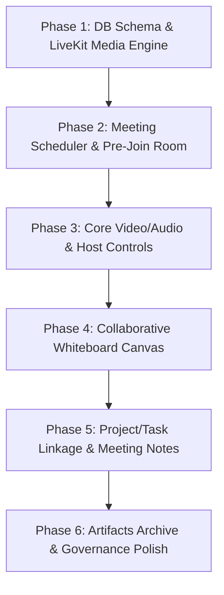

# Implementation Plan: Audio/Video Meetings & Collaborative Whiteboard

## 1. Executive Summary & Architecture Overview
This plan specifies the technical architecture, dependencies, database schema, security controls, and phase-by-phase implementation for **Feature 7: Audio/Video Meetings & Collaborative Whiteboard** in the Interlink Enterprise SaaS platform.

### Architectural Foundation
To support multi-party enterprise audio/video (5–50+ participants) with screen sharing, adaptive bitrate streaming, and interactive real-time whiteboard collaboration, Interlink will employ an **SFU (Selective Forwarding Unit)** WebRTC media architecture powered by **LiveKit**:
- **Media Engine (LiveKit SFU):** Handles video/audio routing, simulcast, dynacast, screen sharing, and media congestion management.
- **Signaling & Authorization (Node.js Backend):** Generates cryptographically signed, short-lived JWT tokens containing meeting-specific and role-based permissions (`canPublish`, `canSubscribe`, `canPublishData`, `isRoomAdmin`).
- **Low-Latency Data Channel:** LiveKit's native WebRTC Data Channel (`room.localParticipant.publishData`) delivers sub-30ms vector synchronization for multi-user whiteboard strokes, shapes, laser pointers, and in-room chat.
- **Multi-Tenant Isolation:** Inherits Interlink's strict company-level scoping: meetings, lobby queues, whiteboard canvases, and meeting notes are permanently isolated by `organization_id` and `company_id`.

---

## 2. Dependencies & Prerequisites

### 2.1 Backend Dependencies (`Interlink/backend`)
```bash
npm install livekit-server-sdk nanoid
```
- **`livekit-server-sdk`**: Issues signed JWT room tokens and handles room management API calls.
- **`nanoid`**: Generates high-entropy, human-friendly meeting room codes (e.g. `int-9b4e-28c1`).

### 2.2 Frontend Dependencies (`Interlink/frontend`)
```bash
npm install @livekit/components-react livekit-client konva react-konva lucide-react
```
- **`@livekit/components-react` & `livekit-client`**: WebRTC room wrappers, participant audio/video grid components, track toggles, and device selection hooks.
- **`konva` & `react-konva`**: High-performance 2D Canvas vector rendering engine for multi-layer drawing, shapes, text, sticky notes, and smooth freehand curves.
- **`lucide-react`**: Consistent enterprise icons for hardware devices, whiteboard toolbars, host actions, and badges.

### 2.3 LiveKit Server Deployment Options
1. **LiveKit Cloud (Recommended for dev/staging):** Free tier includes 100 GB/month bandwidth, instant zero-maintenance setup, and globally distributed TURN/STUN relays.
2. **Self-Hosted Docker LiveKit (Production on-premise):** Single Docker container (`livekit/livekit-server`) configured with Redis and local port mapping.

---

## 3. Database Schema (`backend/models/meetingModel.js`)

All tables are auto-ensured on server startup and enforce multi-tenant isolation.

```sql
-- 1. Meetings Master Table
CREATE TABLE IF NOT EXISTS meetings (
    id INT AUTO_INCREMENT PRIMARY KEY,
    organization_id INT NOT NULL,
    company_id INT NOT NULL,
    project_id INT NULL,
    task_id INT NULL,
    room_code VARCHAR(64) NOT NULL UNIQUE,
    title VARCHAR(255) NOT NULL,
    description TEXT NULL,
    meeting_type ENUM('instant', 'scheduled') DEFAULT 'instant',
    host_id INT NOT NULL,
    scheduled_start DATETIME NULL,
    scheduled_end DATETIME NULL,
    status ENUM('scheduled', 'live', 'ended', 'cancelled') DEFAULT 'scheduled',
    is_lobby_enabled BOOLEAN DEFAULT TRUE,
    is_recording_allowed BOOLEAN DEFAULT FALSE,
    is_guest_allowed BOOLEAN DEFAULT TRUE,
    passcode VARCHAR(32) NULL,
    created_at TIMESTAMP DEFAULT CURRENT_TIMESTAMP,
    FOREIGN KEY (host_id) REFERENCES users(id) ON DELETE CASCADE
);

-- 2. Participants & Attendance Log
CREATE TABLE IF NOT EXISTS meeting_participants (
    id INT AUTO_INCREMENT PRIMARY KEY,
    meeting_id INT NOT NULL,
    user_id INT NULL,
    guest_name VARCHAR(100) NULL,
    guest_email VARCHAR(150) NULL,
    role ENUM('host', 'co_host', 'participant', 'guest') DEFAULT 'participant',
    status ENUM('waiting_room', 'admitted', 'rejected', 'left') DEFAULT 'admitted',
    joined_at DATETIME NULL,
    left_at DATETIME NULL,
    duration_seconds INT DEFAULT 0,
    FOREIGN KEY (meeting_id) REFERENCES meetings(id) ON DELETE CASCADE
);

-- 3. Collaborative Whiteboard State
CREATE TABLE IF NOT EXISTS meeting_whiteboards (
    id INT AUTO_INCREMENT PRIMARY KEY,
    meeting_id INT NOT NULL,
    organization_id INT NOT NULL,
    company_id INT NOT NULL,
    project_id INT NULL,
    title VARCHAR(255) DEFAULT 'Meeting Whiteboard',
    canvas_data LONGTEXT NULL,
    thumbnail_url VARCHAR(500) NULL,
    created_at TIMESTAMP DEFAULT CURRENT_TIMESTAMP,
    updated_at TIMESTAMP DEFAULT CURRENT_TIMESTAMP ON UPDATE CURRENT_TIMESTAMP,
    FOREIGN KEY (meeting_id) REFERENCES meetings(id) ON DELETE CASCADE
);

-- 4. In-Meeting Notes & Summaries
CREATE TABLE IF NOT EXISTS meeting_notes (
    id INT AUTO_INCREMENT PRIMARY KEY,
    meeting_id INT NOT NULL,
    author_id INT NOT NULL,
    notes_content LONGTEXT NULL,
    ai_summary TEXT NULL,
    action_items JSON NULL,
    updated_at TIMESTAMP DEFAULT CURRENT_TIMESTAMP ON UPDATE CURRENT_TIMESTAMP,
    FOREIGN KEY (meeting_id) REFERENCES meetings(id) ON DELETE CASCADE
);

-- 5. Meeting Recordings (Consent-audited)
CREATE TABLE IF NOT EXISTS meeting_recordings (
    id INT AUTO_INCREMENT PRIMARY KEY,
    meeting_id INT NOT NULL,
    organization_id INT NOT NULL,
    company_id INT NOT NULL,
    file_url VARCHAR(500) NOT NULL,
    file_size_bytes BIGINT DEFAULT 0,
    duration_seconds INT DEFAULT 0,
    recorded_by INT NOT NULL,
    created_at TIMESTAMP DEFAULT CURRENT_TIMESTAMP,
    FOREIGN KEY (meeting_id) REFERENCES meetings(id) ON DELETE CASCADE
);
```

---

## 4. Key Screens & User Interface Specification

### Screen 1: Meeting Hub & Scheduler (`/meetings` & `/meetings/new`)
- **Instant Meeting Launcher:** One-click "Start Instant Meeting" button that creates the room and copies the invitation link to the clipboard.
- **Meeting Scheduler Form:**
  - Meeting Title, Agenda, Date, Start Time, and Duration.
  - Optional linkage to an active **Project** or **Task**.
  - Internal attendee selector (filtered strictly by the active company).
  - External guest email invitation field.
  - Security configuration toggles: Waiting Room (Lobby), Passcode, Allow Whiteboard.
- **Upcoming Meetings List:** Chronological card roster with countdown timers and "Join" buttons.

### Screen 2: Pre-Join Green Room (`/meetings/join/:roomCode`)
- **Hardware Tester:** Live camera preview feed, dynamic microphone level audio visualizer, and speaker test chime.
- **Device Switcher:** Dropdowns for Audio Input (Mic), Video Input (Camera), and Audio Output (Speakers/Headphones).
- **Guest Identity Intake:** For unauthenticated external guests, captures Full Name and Email before queueing in the lobby.
- **Entry Gatekeeper:** Shows "Waiting for Host Approval..." with animated status spinner if the waiting room is active.

### Screen 3: Live Meeting Room (`/meetings/room/:roomCode`)
- **Video Stage & Grid:**
  - Adaptive 1–25 tile responsive grid with active speaker border glow.
  - Stage Layout automatically prioritizes screen sharing or active whiteboard presentations while displaying participant video bubbles along the top or side.
- **Bottom Navigation Control Bar:**
  - Microphone Toggle (with device picker popover).
  - Camera Toggle (with device picker popover).
  - Screen Share Toggle (Window, Screen, or Browser Tab with Audio).
  - Whiteboard Split-Screen / Fullscreen Toggle.
  - In-Meeting Chat Drawer & Meeting Notes Drawer.
  - Participant Drawer with Hand Raise list.
  - Red "Leave / End Meeting" button.

### Screen 4: Host Administration Drawer
- **Global Actions:** "Mute All" button with toggle "Allow participants to unmute themselves".
- **Lobby Management:** Real-time queue showing guests waiting for admission with individual **Admit** and **Deny** buttons, plus "Admit All".
- **Participant Actions:** Per-user dropdown to Grant Co-Host, Mute Mic, Disable Camera, Lower Hand, Send to Waiting Room, or Remove from Meeting.
- **Feature Permissions:** Checkboxes to enable/disable Screen Sharing, Whiteboard Editing, and In-Meeting Chat for non-host participants.

### Screen 5: Collaborative Whiteboard Studio
- **Vector Toolbar:**
  - Select / Move / Transform tool.
  - Freehand Pen with color picker and stroke width slider.
  - Highlighter with alpha transparency.
  - Vector Shapes (Rectangle, Circle, Diamond, Arrow, Connector Line).
  - Rich Text Box & Sticky Notes (Yellow, Blue, Green, Pink).
  - Laser Pointer with disappearing transient trail.
  - Eraser (object or stroke eraser).
- **Multiplayer State Sync:** Broadcasts differential drawing commands over LiveKit's WebRTC Data Channel; renders live cursor pointers with participant names.
- **Workspace Actions:**
  - **"Save to Project"** button: Writes vector state and snapshot thumbnail to `meeting_whiteboards` and links to the Project Documents workspace.
  - **"Export"** dropdown: Downloads as high-resolution PNG or SVG.

### Screen 6: Meeting History & Workspace Artifacts (`/meetings/history/:id`)
- Summary card with meeting duration, participant attendance timeline, and linked project/task details.
- Collaborative meeting notes with extracted action items.
- Whiteboard interactive playback and snapshot viewer.
- Recording playback player (if recording was enabled and consented).

---

## 5. Security, Governance & Regulatory Controls

1. **Strict Multi-Tenant Scoping:**
   - Meetings, rooms, and tokens are hard-coded to `organization_id` and `company_id`.
   - Switching companies in the sidebar prevents visibility or token generation for other workspaces.
2. **Ephemeral Cryptographic Access:**
   - No hardcoded room keys. Every participant receives an HMAC-SHA256 signed token valid only for that room and expiring in 4 hours.
3. **Recording Consent & Policy Enforcement:**
   - Recording is **OFF by default**.
   - Initiating a recording requires an explicit Host confirmation modal.
   - Triggers an un-dismissible red flashing recording banner across all participant screens with legal disclosure: *"This meeting is being recorded for workspace documentation."*
4. **Realistic Screen Capture Disclaimer:**
   - In compliance with operating system security boundaries, the pre-join check and meeting room include a persistent notice:
   > [!NOTE]
   > Interlink enforces in-app recording governance and permission boundaries. However, web browsers cannot prevent external operating system captures (e.g., OBS Studio, Windows Snipping Tool, or external capture hardware).

---

## 6. Phase-by-Phase Implementation Roadmap



### Phase 1: Database Foundation & LiveKit Integration
- Install `livekit-server-sdk` in backend.
- Create `meetingModel.js` with tables (`meetings`, `meeting_participants`, `meeting_whiteboards`, `meeting_notes`, `meeting_recordings`).
- Create `meetingController.js` with token generation endpoint (`POST /api/meetings/:roomCode/token`).
- Add environment variables (`LIVEKIT_API_KEY`, `LIVEKIT_API_SECRET`, `LIVEKIT_URL`) to `.env`.

### Phase 2: Meeting Scheduler & Pre-Join Green Room
- Install `@livekit/components-react` and `livekit-client` in frontend.
- Build `MeetingSchedulerModal.jsx` and `MeetingsPage.jsx` with Instant & Scheduled meeting creation.
- Build `PreJoinRoom.jsx` with camera/microphone self-test, audio level meters, and device selection dropdowns.
- Implement Waiting Room lobby polling/websocket hook for guest approvals.

### Phase 3: Live Meeting Room & Host Controls
- Build `MeetingRoom.jsx` with responsive video grid, active speaker highlight, and screen sharing stage.
- Implement bottom Control Bar (Mic, Cam, Screen Share, Leave).
- Build `HostControlsDrawer.jsx` (Mute all, Admit/Deny waiting room guests, Kick, Lock meeting).
- Implement in-meeting text chat over LiveKit data channels.

### Phase 4: Collaborative Whiteboard Engine
- Install `konva` and `react-konva`.
- Build `MeetingWhiteboard.jsx` canvas component with drawing tools, sticky notes, vector shapes, and text.
- Connect real-time delta synchronization over WebRTC data channels (`room.localParticipant.publishData`).
- Implement Live Participant Pointers with participant name tags.
- Implement "Save to Project Workspace" and "Export to PNG" features.

### Phase 5: Project & Task Integration & Meeting Notes
- Add "Start Meeting" and "Link Meeting" buttons in `ProjectWorkspacePage.jsx` and `TasksPage.jsx`.
- Implement `MeetingNotesPanel.jsx` allowing participants to collaborate on agenda and action items.
- Deep-link meeting room URLs directly inside task cards and project overview tabs.

### Phase 6: Post-Meeting Artifacts, Audit & Governance
- Build `MeetingSummaryPage.jsx` displaying attendance records, notes, and whiteboard snapshots.
- Enforce recording governance policy, host consent modal, and prominent in-room recording indicator.
- Conduct verification across multi-company workspaces (Company A vs Company B isolation).
